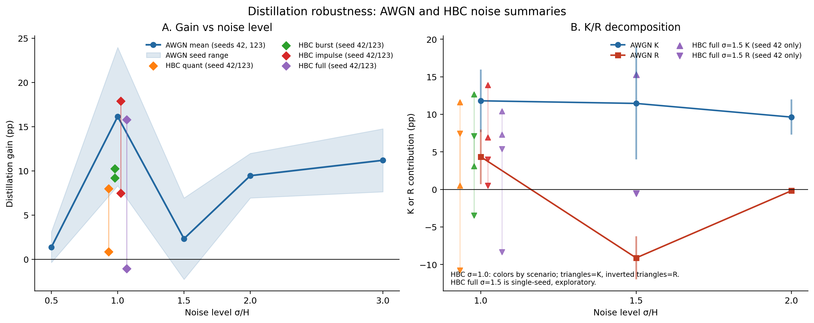

# 蒸馏抗噪续接：HBC 双种子汇总与剂量相图（2026-11-19）

## 状态与数据来源

本报告基于仓库中已存在的匿名汇总 JSON，**不是本机重新训练结果**。工作树初始 HEAD 为 `91654bb`（任务交接提交），但 `git pull --ff-only` 因 GitHub 凭证不可用失败；因此结论只对应本机已检出的版本。

- HBC σ/H=1.0 四场景：seed 42、123 的 `sign_check_*.json` 与 `kd_decomposition_*.json` 均存在。
- AWGN：seed 42、123 的 σ=0.5、1.0、1.5、2.0、3.0 红利汇总齐全；K/R 汇总在 σ=1.0、1.5、2.0 齐全。
- HBC full σ/H=1.5：只找到 seed 42 K/R 汇总（K=+15.28pp、R=−0.52pp、总红利=+14.76pp）。
- EMG 17 类：旧相图文档记有单种子多 σ 结果，但本机未找到可用于双种子复核的对应数据和逐种子汇总。
- 训练数据目录 `data_4class_cross*` 当前均不存在；Python 环境 `ship` 有 PyTorch 2.12.0.dev+cu128，但无 MNE。MNE 不影响读汇总 JSON；缺失的 NPZ 则使本机无法独立复跑 HBC/EMG 训练。

因此以下是对已提交结果的复核整理和图示。未把两颗随机种子当作独立被试做显著性推断，也没有从汇总指标伪造 Wilcoxon p 值。要做有效的被试配对检验，需有逐被试预测/准确率，而现存 JSON 只有整体指标。

## HBC 四场景（σ/H=1.0）：seed 42/123

| 场景 | 红利 seed42 | 红利 seed123 | 两种子均值 | K 均值 | R 均值 | 逐种子红利符号 |
|---|---:|---:|---:|---:|---:|---| 
| quant | +7.99 | +0.87 | +4.43 | +6.08 | −1.65 | + / + |
| burst | +10.24 | +9.20 | +9.72 | +7.90 | +1.83 | + / + |
| impulse | +17.88 | +7.47 | +12.68 | +10.42 | +2.26 | + / + |
| full | +15.80 | −1.04 | +7.38 | +8.86 | −1.48 | + / − |

单位均为百分点；均值按两个种子等权计算，四舍五入到两位。结论：

1. 红利总体偏正，但不是每个场景、每个种子都正：8 个场景×种子组合中 7 个为正；full 的 seed 123 为 −1.04pp。不能写成“HBC 四场景稳健全正”。
2. K 在 8/8 个组合中为正，支持“此设置下 teacher 软标签项 K 均为正”的描述；但只有两种子且没有逐被试区间，仍是有限证据。
3. R 明显依场景和种子变化。quant、burst、full 的 R 均值靠近零或为负，且多个场景变号；“量化打 K 不打 R”不成立，原先“R 恒正”也不成立。
4. “脉冲放大 K”仅是这两种子下较大的均值趋势（K=+10.42pp），不能当稳健机制结论。
5. teacher−student 的 seed 42/123 方向多处翻转，符号判据不适合作为单种子结论；full 的红利亦跨种子翻号。保留这种不稳定性，后续报告不得只展示均值。

## 相图读法

图中 AWGN 曲线显示两种子均值和范围；HBC σ/H=1.0 点叠加各场景两种子值。右图展示 AWGN K/R 两种子范围及 HBC 的逐种子 K/R。HBC full σ/H=1.5 仅有 seed 42，已单独标为探索性点，不纳入双种子推断。图由 `plot_kd_hbc_phase_20261119.py` 从仓库 JSON 生成。

AWGN 总红利两种子均值：σ=0.5 +1.39pp、1.0 +16.15pp、1.5 +2.34pp、2.0 +9.46pp、3.0 +11.20pp。区间跨零/种子方向不一的点不能泛化成稳定剂量效应。

AWGN K/R 双种子均值：

| σ | K | R | 总红利 |
|---:|---:|---:|---:|
| 1.0 | +11.81 | +4.34 | +16.15 |
| 1.5 | +11.46 | −9.12 | +2.34 |
| 2.0 | +9.64 | −0.18 | +9.46 |

## 后续两项的现有证据与判定

### HBC full × σ/H=1.5

目前只有 seed 42 的汇总：hard 29.34%、label smoothing 28.82%、distilled 44.10%，即 K=+15.28pp、R=−0.52pp、总红利=+14.76pp。它提示 R 可能在 HBC full 下也为负，但 R 仅 −0.52pp，且缺 seed 123，不能与 AWGN 的 R 转负机制等量齐观。**双种子确认未完成。**

### EMG 17 类加噪

旧研究文档记录 σ=0.5/1.0/1.5/2.0 的红利分别 −0.92/−0.18/−1.41/+1.16pp，均接近零；同时 17 类任务下 teacher 约贴近 chance。当前未找到 seed 123 对应的完整 K/R 汇总或本地训练数据。该结果只作为单种子历史观察，**不能作为跨范式确认，也不支持进一步机制主张**。

## 本轮结论与停靠点

- 已完成：核对现有 HBC seed 42/123 汇总；整理红利/K/R 两种子值；生成 AWGN+HBC 剂量相图；从旧记录抽取 HBC σ=1.5 与 EMG 的边界证据。
- 未完成：本机重新训练 HBC seed 123；HBC full σ=1.5 seed 123；EMG 17 类 seed 123；逐被试配对检验。原因是本机没有对应数据目录/NPZ，且现存 JSON 无逐被试结果。
- 解释边界：这批结果支持在 BCIC 四分类固定划分、当前噪声注入协议和少标签训练设定下，蒸馏红利/K/R 对噪声类型及随机种子敏感。它们不是对蒸馏普遍抗噪的证明。R 转负现象受 Lukasik et al., ICML 2020 已有结论威胁；论文贡献应限定为生理信号场景中的定量分解及跨数据集核验，不宣称概念级空白。
- 下一步唯一优先事项：把 `data_4class_cross*`（包括确定性噪声生成源和冻结划分）及 EMG 对应处理产物放到可运行训练环境，保留现有 split 与脚本参数；先复跑 HBC full σ/H=1.5 seed 123并导出逐被试结果，再跑 EMG seed 123。获取逐被试配对数据后再做配对统计；不以两颗 seed 代替被试统计单位。
